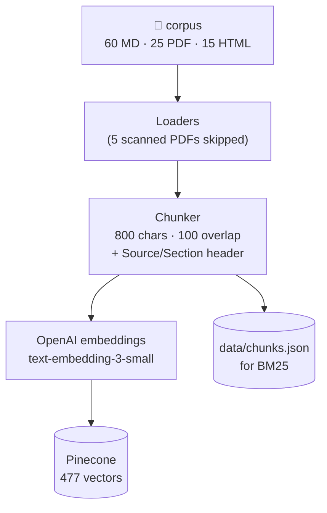
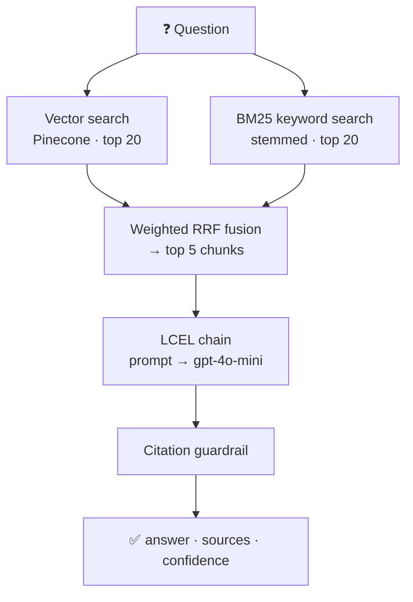
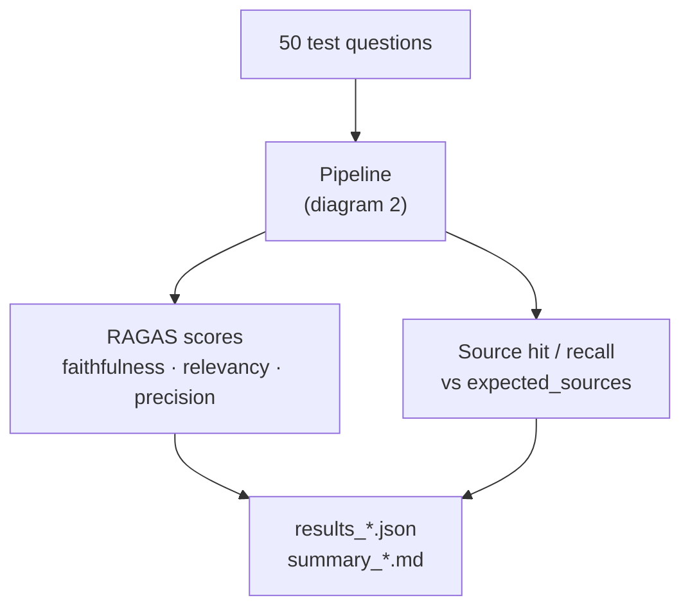

# checkpoint-rag

An internal support assistant for a Customer Success team, built with retrieval-augmented generation (RAG). It indexes a SaaS company's knowledge base (60 Markdown product docs, 25 PDF runbooks, 15 HTML resolved support tickets), retrieves the most relevant passages for a question using hybrid search (vector + BM25 keyword search), and has an LLM answer **only from those passages**. Every answer comes back as structured output with the answer, the source documents it used, and a confidence level. An evaluation harness scores the system on 50 test questions with ground-truth answers, so every design decision below is backed by a measurement.

**Loom walkthrough:** _add link here_

**Stack:** Python 3.11 · LangChain (LCEL) · OpenAI `gpt-4o-mini` + `text-embedding-3-small` · Pinecone (serverless) · `rank-bm25` · RAGAS · pytest

---

## Architecture

### 1. Ingestion (`src/ingest.py`, run once)



### 2. Answering a question (`src/pipeline.py`)



### 3. Evaluation (`evals/harness.py`)



## Chunking strategy

| Format | How it's loaded | How it's chunked | Why |
|---|---|---|---|
| **Markdown** (60 product docs) | Read as-is | Split on `#`/`##`/`###` headings first, then any section over 800 characters is split further (100 overlap) | The docs are short (130–400 words) and cleanly structured, with one topic per heading. Splitting on headings keeps a topic whole (e.g. "Workflow limits" stays one chunk with all three limits). |
| **PDF** (25 runbooks) | `pypdf` text extraction | 800 characters, 100 overlap | Runbooks are single-page (~200–270 words) with no reliable heading markup after extraction. |
| **Scanned PDF** (5 of the 25) | **Skipped and logged by name** | n/a | No text layer. OCR adds a system dependency (Tesseract) and its own error rate; only 1 of 50 test questions (Q050) needs a scanned file. A conscious tradeoff, measured below and first in line for "another week". |
| **HTML** (15 tickets) | BeautifulSoup, `script`/`style` removed, conversation order kept | 800 characters, 100 overlap, ticket title used as the section | The resolution is often only in the last agent reply, so order matters, and the title keeps a chunk from the end of a ticket tied to its topic. |

**Every chunk gets a small header** before embedding:

```
Source: product-docs/workflows/creating-workflows.md
Section: Creating Workflows > Workflow limits

## Workflow limits
- Maximum steps per workflow: **100**
...
```

Without it, a chunk saying "Maximum steps: 100" carries no hint that it's about workflows. With it, both vector search and BM25 can match the chunk to the topic.

**Why 800 characters / 100 overlap:** the corpus is small (about 11,000 words of docs), and most heading-sections already fit in one chunk. 800 characters keeps a procedure or a limits list intact without mixing topics; 100 characters of overlap means a sentence cut at a boundary still appears whole in one of the two chunks. Result: 477 chunks, average about 380 characters.

**Chunk IDs are deterministic** (`source::position`), so re-running ingestion overwrites the same vectors instead of creating duplicates.

## Retrieval strategy

**Improvement implemented: hybrid search** (Pinecone vector search + BM25 keyword search, merged with weighted Reciprocal Rank Fusion).

**Why hybrid:** support questions mix paraphrases ("users can't log in" → "SSO redirect loop"), which vector search handles, with exact identifiers (error codes like `429`, ticket IDs like `HX-1042`), which keyword search handles. Each method covers the other's blind spot.

**What I measured, and what changed my mind.** The first hybrid version (standard RRF k=60, equal weights, plain word-matching BM25) was **worse than vector-only on every metric**. Debugging Q003 ("How much does the Pro plan cost?") showed why: vector search ranked the correct chunk #1, but hybrid dropped it from the top 5 entirely, because

1. BM25 had no stemming, so "plan" did not match "Plans", and stopwords like "how" and "does" counted as matches, and
2. RRF with k=60 rewards agreement: a chunk ranked ~#10 by both methods outscored a chunk ranked #1 by only one.

Two fixes: **stemming + stopword removal** in the BM25 tokenizer, and **tuned fusion** (k=10 so a strong #1 isn't outvoted; BM25 weighted 0.5 because it is the weaker retriever on this corpus). Settings were chosen with `evals/compare_retrieval.py`, which compares strategies against `expected_sources` without calling the LLM:

| Strategy (top 5) | hit@5 | recall@5 | MRR@5 |
|---|---|---|---|
| Vector only | 1.00 | 0.88 | **0.95** |
| BM25 only (stemmed) | 0.96 | 0.84 | 0.83 |
| Hybrid RRF k=60, weights 1.0 / 1.0 | 0.98 | 0.86 | 0.90 |
| Hybrid RRF k=60, weights 1.0 / 0.5 | 0.98 | 0.88 | 0.91 |
| Hybrid RRF k=10, weights 1.0 / 1.0 | 1.00 | 0.87 | 0.90 |
| **Hybrid RRF k=10, weights 1.0 / 0.5 (shipped)** | **1.00** | **0.90** | 0.92 |

Stemming alone took BM25 from 43/50 to 48/50 hit@5 (MRR 0.66 → 0.83).

**Honest read:** on this test set, vector search is already near the ceiling, so the differences are small. The shipped hybrid matches vector on hit rate and has the best recall (more of the needed documents reach the LLM, which matters for multi-document questions). Its real value is exact-identifier queries, which this test set contains few of; see "another week".

## Generation prompt

Chain: `ChatPromptTemplate | ChatOpenAI(gpt-4o-mini, temperature=0).with_structured_output(RAGAnswer)`

```text
SYSTEM:
You are an internal support assistant for a Customer Success team.
You answer questions using ONLY the context blocks provided below.

Rules:
1. Use only facts stated in the context. Do not use outside knowledge or guess.
2. If the context does not contain the answer, say so plainly and set confidence to "low".
3. Include specific numbers, limits, error codes and steps exactly as written in the context.
4. Keep the answer concise: a few sentences, or a short numbered list for procedures.
5. In "sources", list the source path of every context block you used, copied exactly.
6. If sources disagree, say so and prefer the most specific one (a resolved ticket or runbook
   over general docs for edge cases).

HUMAN:
Context:
[1] source: product-docs/workflows/creating-workflows.md
<chunk text>
---
[2] source: ...

Question: {question}
```

Output schema (Pydantic): `answer: str`, `sources: list[str]`, `confidence: "low" | "medium" | "high"`, where the confidence levels are defined in the schema (high = stated directly, medium = needs combining or inference, low = missing or partial).

**Why this structure:**
- **"ONLY the context" + "say so plainly"** target faithfulness. For a support team, a confident wrong answer is worse than "I don't know"; tested with an out-of-scope question, which returns low confidence and no sources.
- **"Exactly as written" for numbers and codes**: support answers depend on details like "100 steps" or "HTTP 429".
- **Numbered, source-labelled context blocks** give the model something concrete to cite.
- **Rule 6** exists because the corpus repeats facts across docs, and edge cases often live only in tickets or runbooks.
- **Structured output** (not "please answer in JSON") means the response is validated, and the `Literal` type makes an invalid confidence impossible.
- **`temperature=0`** for repeatable answers, which makes eval runs comparable.
- **Guardrail after the LLM:** any cited source that was not actually retrieved is removed, so the model can't invent a citation.

## Eval results

50 queries (20 easy, 20 medium, 10 hard), top 5 chunks, `gpt-4o-mini` as both generator and RAGAS judge.

| System | Faithfulness | Answer relevancy | Context precision | Source hit |
|---|---|---|---|---|
| Target | ≥ 0.70 | | ≥ 0.60 | |
| Vector only (baseline) | 0.94 | 0.84 | **0.89** | 1.00 |
| Hybrid, first version | 0.93 | 0.81 | 0.87 | 0.96 |
| **Hybrid, tuned (shipped)** | **0.97** | **0.86** | 0.88 | **1.00** |

Full per-query output: `evals/results/results_hybrid.json`; readable summary with the weakest queries: `evals/results/summary_hybrid.md` (generated by `python -m evals.harness`).

Differences of about 0.01–0.03 are close to LLM-judge run-to-run noise; the clear signals are the first hybrid version being worse and the tuned version recovering Q002/Q003 and raising faithfulness.

### Representative failure cases

**1. Q003, "How much does the Pro plan cost?" (retrieval failure, fixed).**
In the first hybrid version, the answer ($299/month, in `billing/plans.md > Pro — $299/month`) was ranked #1 by vector search but dropped from the hybrid top 5, so the model correctly answered with low confidence. Root cause was retrieval, not generation: BM25 without stemming ("plan" ≠ "Plans") and RRF k=60 favoring chunks both methods mildly liked. Fixed by stemming and tuned fusion; measured with `compare_retrieval.py` and confirmed in the full eval.

**2. Q002, "How long can a workflow run before it times out?" (evaluation noise).**
Scored as a retrieval miss in the first hybrid run, yet answered correctly with high confidence. The test set lists only `creating-workflows.md` as the expected source, but the same 30-minute limit also appears in ticket `HX-1234`, which was retrieved. The corpus deliberately repeats facts across documents, so source-based metrics under-count correct retrievals. A fairer metric would accept any document that contains the ground-truth fact.

**3. Q050, P0 outage communication obligations (known coverage gap + overconfidence).**
One of its two expected sources, `runbooks/customer-ops/custom-sla-handling.pdf`, is a scanned PDF that ingestion skips. The P0 runbook is retrieved, so the communication timeline is answered, but the SLA-credit part of the ground truth cannot be. The system still reports **high** confidence; in fact all 50 answers in the shipped run are "high". Confidence is self-reported by the LLM and isn't calibrated against retrieval coverage. This is a direct consequence of the OCR tradeoff and the top item below.

## How to run

```bash
git clone <your-repo-url> && cd checkpoint-rag && python -m venv venv && source venv/bin/activate && pip install -r requirements.txt
cp .env.example .env            # then add OPENAI_API_KEY and PINECONE_API_KEY
python -m src.ingest --corpus ./corpus
python -m src.pipeline "What's the maximum number of steps allowed in a single workflow?"
python -m evals.harness
```

On Windows, activate with `venv\Scripts\activate` and copy with `copy .env.example .env`.

Other commands:

```bash
python -m pytest tests/ -v                       # 12 tests; API tests auto-skip without keys
python -m evals.harness --mode vector            # baseline for before/after
python -m evals.harness --limit 5                # quick, cheap smoke test
python -m evals.compare_retrieval                # retrieval strategies, no LLM calls
python -m src.ingest --corpus ./corpus --dry-run # load + chunk only, free
```

## What I'd do with another week (ranked)

1. **Calibrate confidence.** All 50 shipped answers are "high", including Q050, which is provably incomplete. I'd derive confidence from signals the system can measure (how many of the retrieved chunks the answer actually uses, retrieval score margin, whether the generator cited more than one source for multi-part questions) instead of the LLM's self-report, then check calibration on the test set: accuracy per confidence bucket should rise from low → high. This ranks first because a CSM acts on the confidence label, and today it carries no information.
2. **OCR the 5 scanned runbooks** (Tesseract via `pytesseract`), with a text-quality check that logs low-confidence pages. Measured impact: Q050 recall, plus 3–5 new test questions targeting those runbooks, since the current set barely covers them.
3. **Expand and harden the test set.** Add queries with exact identifiers (error codes, ticket IDs) and heavy paraphrases, where hybrid and vector should differ, and run each eval 3 times to measure judge variance, so I can tell a real 0.02 change from noise. Also switch source scoring to "any document containing the ground-truth fact" (fixes the Q002 class of false misses).
4. **Per-document diversity cap** (max 2 chunks per document in the top 5). One ticket currently fills 3 of 5 slots on some queries; hard questions like Q044 need 4 different documents. Measure recall@5 on the hard subset.
5. **Per-query observability:** log retrieved chunk IDs, token cost, and latency per stage, with p95 latency alerting at 3s (current average is about 2–3 s end to end, but I have no tail-latency signal yet).
6. **Try a cross-encoder reranker** over the fused top 20 and compare against the current fusion on the expanded test set; only worth its added latency and cost if it beats hybrid on the new, harder questions.

## Repo structure

```
checkpoint-rag/
├── README.md
├── requirements.txt            # pinned versions
├── .env.example                # required env vars, no real keys
├── corpus/                     # provided knowledge base (100 docs) + test_set.json
├── src/
│   ├── ingest.py               # load → chunk → embed → index
│   ├── retrieve.py             # vector, BM25, weighted RRF hybrid
│   ├── generate.py             # LCEL chain → structured answer + citation guardrail
│   └── pipeline.py             # question → answer
├── evals/
│   ├── harness.py              # runs the 50 queries, RAGAS + source metrics, JSON + markdown
│   ├── compare_retrieval.py    # retrieval strategy comparison without the LLM
│   ├── test_set.json           # the 50 provided queries
│   └── results/                # output directory
├── tests/                      # pytest: ingest, retrieve, generate, evals
└── notebooks/exploration.ipynb # scratch work
```